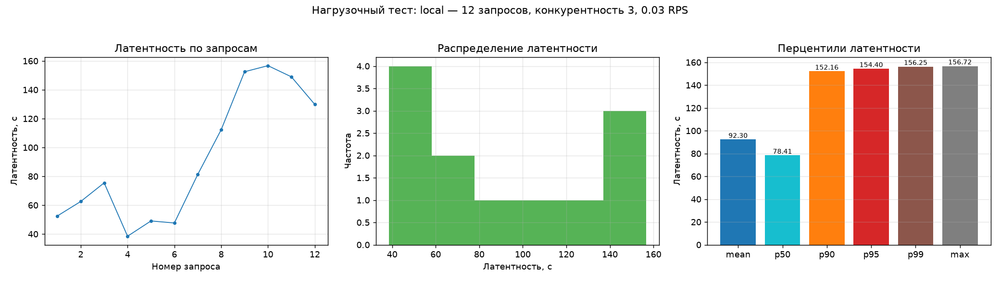
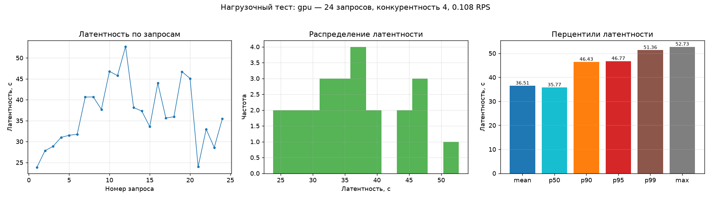
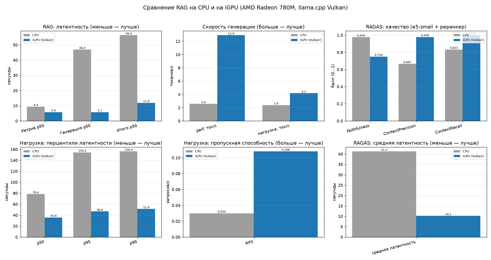

# RAG по нормативным документам — отчёт о качестве и производительности

## 1. Стенд
- **ОС**: Linux 7.0.0-38-generic
- **Python**: 3.13.9
- **CPU**: x86_64 x16
- **RAM, ГБ**: 27.1
- **Провайдер LLM**: openai
- **LLM**: meno-lite
- **Коллекция по умолчанию**: normdoc_e5_small
- **Qdrant**: http://localhost:6335
- **GPU**: llama.cpp Vulkan (AMD Radeon 780M iGPU)
- **LLM-инференс**: llama.cpp Vulkan (AMD Radeon 780M iGPU)

## 2. Корпус
- **Документов**: 13
- **Чанков**: 907
- **Типы**: form: 1, law: 4, regulation: 1, release_notes: 1, standard: 6
- **Дублей исключено**: 1

## 3. Качество ответов (RAGAS)
Судья — локальная LLM, эмбеддинги — локальные. Faithfulness — опора ответа на контекст, ContextPrecision — доля релевантных чанков, ContextRecall — полнота контекста относительно эталона.

| Конфигурация | LLM | Эмбеддинги | Реранкер | Чанкинг | Faithfulness | ContextPrecision | ContextRecall | Ср. латентность, с |
|---|---|---|---|---|---|---|---|---|
| `baseline_igpu` | meno-lite (Vulkan iGPU) | e5_small | нет | semantic | 0.611 | 0.672 | 0.833 | 8.12 |
| `e5_rerank_igpu` | meno-lite (Vulkan iGPU) | e5_small | да | semantic | 0.750 | 0.978 | 1.000 | 10.23 |

**Контрольный прогон** на golden-наборе (`data/qa/golden_qa.jsonl`, вопросов: 6): Faithfulness **0.750**, ContextPrecision **0.978**, ContextRecall **1.000**; судья — `meno-lite`, LLM — `meno-lite`, коллекция `normdoc_e5_small`, средняя латентность 10.23 с.

Quality gate: **ПРОЙДЕН** — faithfulness 0.750/0.7; llm_context_precision_with_reference 0.978/0.4; context_recall 1.000/0.6.

## 4. Производительность (perf-тесты)
Замеры латентности ретривера и генерации, скорости генерации (ток/с) и длины ответа.

| Конфигурация | LLM | Коллекция | Реранкер | Ретрив p50, с | Ретрив p95, с | Генерация p50, с | Итого p50, с | ток/с | Ответ, симв. |
|---|---|---|---|---|---|---|---|---|---|
| `cpu` | bonsai | normdoc_e5_small | да | 9.372 | 9.876 | 46.927 | 56.385 | 2.57 | 229 |
| `gpu` | meno-lite | normdoc_e5_small | да | 5.779 | 7.159 | 5.717 | 11.915 | 12.91 | 243 |

## 5. Нагрузочное тестирование инференса
HTTP-нагрузка на `/answer` под конкурентностью: RPS, перцентили латентности, ошибки, токены/с. Графики строятся `scripts/load_test.py`.

| Конфигурация | Запросов | Конкурентность | RPS | p50, с | p95, с | p99, с | Ошибок | ток/с |
|---|---|---|---|---|---|---|---|---|
| `cpu` | 12 | 3 | 0.03 | 78.41 | 154.40 | 156.25 | 0 | 2.39 |
| `gpu` | 24 | 4 | 0.11 | 35.77 | 46.77 | 51.36 | 0 | 4.18 |

Графики латентности (латентность по запросам / распределение / перцентили):




## 6. Сравнение CPU и iGPU (Vulkan)
Сопоставление качества и производительности одного пайплайна на CPU и на встроенной графике (llama.cpp Vulkan). График строится `scripts/compare_plots.py`.

| Метрика | CPU | iGPU (Vulkan) | iGPU vs CPU |
|---|---|---|---|
| Perf: ретрив p50, с | 9.37 | 5.78 | ×1.6 |
| Perf: генерация p50, с | 46.93 | 5.72 | ×8.2 |
| Perf: итого p50, с | 56.38 | 11.91 | ×4.7 |
| Perf: скорость, ток/с | 2.57 | 12.91 | ×5.0 |
| Нагрузка: p50, с | 78.41 | 35.77 | ×2.2 |
| Нагрузка: p95, с | 154.40 | 46.77 | ×3.3 |
| Нагрузка: p99, с | 156.25 | 51.36 | ×3.0 |
| Нагрузка: RPS | 0.03 | 0.11 | ×3.6 |
| Нагрузка: скорость, ток/с | 2.39 | 4.18 | ×1.7 |
| RAGAS: faithfulness | 0.98 | 0.75 | ×0.8 |
| RAGAS: context precision | 0.67 | 0.98 | ×1.5 |
| RAGAS: context recall | 0.83 | 1.00 | ×1.2 |
| RAGAS: средняя латентность, с | 41.28 | 10.23 | ×4.0 |

_CPU — модель `bonsai` 27B, iGPU — `Meno-Lite-0.1` 7B (модели различаются); ускорение отражает вклад сервинга на GPU при прочих равных условиях стенда._



## 7. Мониторинг Langfuse (трейсы и latency)
Хост: `file://results/traces_gpu.jsonl`, трейсов: **6**, средняя латентность: **13.24 с**.

| Trace | Вопрос | Латентность, с | Спаны (retrieve / generate, с) | Чанков |
|---|---|---|---|---|
| `local-1791746006532` | Сколько классов защиты устанавливается для средств контейнеризации Требованиями  | 14.21 | retrieve: 8.74 / generate: 5.47 | 5 |
| `local-1791746021789` | Какие требования к паролю пользователя средства контейнеризации 4 класса защиты  | 15.26 | retrieve: 5.63 / generate: 9.62 | 5 |
| `local-1791746031086` | На какой срок выдаётся сертификат соответствия процессов безопасной разработки п | 9.30 | retrieve: 6.13 / generate: 3.17 | 5 |
| `local-1791746044968` | В какой срок ФСТЭК России рассматривает материалы сертификации, если экспертное  | 13.88 | retrieve: 5.91 / generate: 7.97 | 5 |
| `local-1791746058144` | Каким приказом утверждён и введён в действие ГОСТ Р 58412—2019? | 13.18 | retrieve: 4.73 / generate: 8.45 | 5 |
| `local-1791746071768` | На каком международном стандарте основан ГОСТ Р 59407—2021? | 13.62 | retrieve: 7.25 / generate: 6.37 | 5 |

## 8. Тесты
Итог последнего прогона: **44 passed in 53.20s**

## 9. Каталог рекомендованных РФ-моделей для локального RAG
| Модель | Организация | Тип | Параметры | Контекст | Лицензия | HuggingFace | Запуск |
|---|---|---|---|---|---|---|---|
| GigaChat3.1-10B-A1.8B | Sber / ai-sage | llm | 10B (активных 1.8B) | 262144 | см. HF | [ai-sage/GigaChat3.1-10B-A1.8B](https://huggingface.co/ai-sage/GigaChat3.1-10B-A1.8B) | llama.cpp / ollama |
| GigaChat-20B-A3B-instruct-v1.5 | Sber / ai-sage | llm | 21B (активных 3B) | 131072 | см. HF | [ai-sage/GigaChat-20B-A3B-instruct-v1.5](https://huggingface.co/ai-sage/GigaChat-20B-A3B-instruct-v1.5) | llama.cpp / ollama |
| GigaChat (облачный API) | Sber | llm | —B | 131072 | проприетарная (API) | — | api |
| Avito A-vibe | Avito (AvitoTech) | llm | —B | 32768 | проприетарная (веса не опубликованы) | — | api / OpenAI-совместимый эндпоинт |
| Meno-Lite-0.1 | Meno AI | llm | 7B | 32768 | см. HF | [Menlo/Meno-Lite-0.1](https://huggingface.co/Menlo/Meno-Lite-0.1) | llama.cpp / ollama |
| T-lite-it-2.1 | T-Bank (t-tech) | llm | 8B | 40960 | см. HF | [t-tech/T-lite-it-2.1](https://huggingface.co/t-tech/T-lite-it-2.1) | llama.cpp / ollama |
| QVikhr-3-8B-Instruction | Vikhrmodels | llm | 8B | 40960 | Apache-2.0 | [Vikhrmodels/QVikhr-3-8B-Instruction](https://huggingface.co/Vikhrmodels/QVikhr-3-8B-Instruction) | llama.cpp / ollama |
| RuadaptQwen3-8B-Hybrid | RefalMachine | llm | 8B | 40960 | Apache-2.0 | [RefalMachine/RuadaptQwen3-8B-Hybrid](https://huggingface.co/RefalMachine/RuadaptQwen3-8B-Hybrid) | llama.cpp / ollama |
| ruadapt_qwen2.5_7B_instruct | RefalMachine | llm | 7B | 32768 | Apache-2.0 | [RefalMachine/ruadapt_qwen2.5_7B_ext_u48_instruct](https://huggingface.co/RefalMachine/ruadapt_qwen2.5_7B_ext_u48_instruct) | llama.cpp / ollama |
| Saiga Llama3 8B | IlyaGusev | llm | 8B | 8192 | см. HF | [IlyaGusev/saiga_llama3_8b_gguf](https://huggingface.co/IlyaGusev/saiga_llama3_8b_gguf) | llama.cpp / ollama |
| Vikhr-YandexGPT-5-Lite-8B-it | Vikhrmodels | llm | 8B | 32768 | см. HF | [Vikhrmodels/Vikhr-YandexGPT-5-Lite-8B-it](https://huggingface.co/Vikhrmodels/Vikhr-YandexGPT-5-Lite-8B-it) | llama.cpp / ollama |
| Qwen2.5-7B-Instruct | Alibaba | llm | 7B | 32768 | Apache-2.0 | [Qwen/Qwen2.5-7B-Instruct](https://huggingface.co/Qwen/Qwen2.5-7B-Instruct) | llama.cpp / ollama |
| Ternary Bonsai 2 27B | PrismML | llm | 27B | 65536 | см. HF | — | llama.cpp |
| BAAI/bge-m3 | BAAI | embedding | 0.57B | 8192 | MIT | [BAAI/bge-m3](https://huggingface.co/BAAI/bge-m3) | sentence-transformers |
| multilingual-e5-small | intfloat | embedding | 0.12B | 512 | MIT | [intfloat/multilingual-e5-small](https://huggingface.co/intfloat/multilingual-e5-small) | sentence-transformers |
| Giga-Embeddings-instruct | Sber / ai-sage | embedding | —B | 8192 | см. HF | [ai-sage/Giga-Embeddings-instruct](https://huggingface.co/ai-sage/Giga-Embeddings-instruct) | sentence-transformers (trust_remote_code) |
| USER-bge-m3 | deepvk | embedding | 0.57B | 8194 | MIT | [deepvk/USER-bge-m3](https://huggingface.co/deepvk/USER-bge-m3) | sentence-transformers |
| ru-en-RoSBERTa | ai-forever | embedding | 0.4B | 512 | MIT | [ai-forever/ru-en-RoSBERTa](https://huggingface.co/ai-forever/ru-en-RoSBERTa) | sentence-transformers |
| BAAI/bge-reranker-v2-m3 | BAAI | reranker | 0.57B | 8192 | Apache-2.0 | [BAAI/bge-reranker-v2-m3](https://huggingface.co/BAAI/bge-reranker-v2-m3) | sentence-transformers CrossEncoder |
| Giga-Retrieval-instruct | Sber / ai-sage | reranker | —B | 8192 | см. HF | [ai-sage/Giga-Retrieval-instruct](https://huggingface.co/ai-sage/Giga-Retrieval-instruct) | transformers (trust_remote_code) |

## 10. Инфраструктура и сервинг (Docker)
Приложение и инфраструктура упакованы в `docker-compose.yml`. Профили:

| Профиль | Назначение | Бэкенд llama.cpp |
|---|---|---|
| `ai395` | AMD Ryzen AI MAX+ 395 / Radeon 8060S | Vulkan, сборка из исходников (`/dev/dri`,`/dev/kfd`) |
| `amd7840hs` | AMD Ryzen 7 7840HS / Radeon 780M (iGPU) | Vulkan, предсобранный PrismML (`/dev/dri`) |
| `rtx3060` | NVIDIA RTX 3060 (отдельный бокс), sm_86 | CUDA (nvidia runtime) |
| `rocm` | AMD через ROCm/HIP (gfx1151) | HIP/ROCm |
| `cpu` | Любая машина без GPU | CPU |
| `monitoring` | Self-hosted Langfuse (Postgres, ClickHouse, Redis, MinIO) | — |
| `tools` | Разовые задачи: индексация, RAGAS, load-тесты | — |

Запуск (пример для AI MAX+ 395 с мониторингом):

```bash
docker compose --profile ai395 --profile monitoring up -d --build
```

Активные сервисы: `langfuse-minio`, `langfuse-minio-init`, `langfuse-postgres`, `langfuse-redis`, `langfuse-clickhouse`, `langfuse-worker`, `qdrant`, `langfuse-web`, `llama-vulkan`, `app`.

## 11. Воспроизведение
```bash
# 1) поднять стек (выберите профиль железа)
docker compose --profile ai395 --profile monitoring up -d --build      # AI MAX+ 395 (Vulkan, из исходников)
docker compose --profile amd7840hs --profile monitoring up -d --build   # Ryzen 7840HS/780M (предсобранный Vulkan)

# 2) корпус и индекс
docker compose --profile tools run --rm app python scripts/prepare_docs.py
docker compose --profile tools run --rm app python scripts/build_index.py --reset \
    --collection normdoc_e5_small

# 3) качество (RAGAS) + производительность по конфигурациям
docker compose --profile tools run --rm app python scripts/compare_configs.py --limit 6

# 4) нагрузочный тест с графиками
docker compose --profile tools run --rm app python scripts/load_test.py \
    --url http://app:8000 --requests 40 --concurrency 4

# 5) графики сравнения CPU и iGPU, экспорт трейсов и сборка отчёта
docker compose --profile tools run --rm app python scripts/compare_plots.py
docker compose --profile tools run --rm app python scripts/langfuse_report.py
docker compose --profile tools run --rm app python scripts/report.py
```